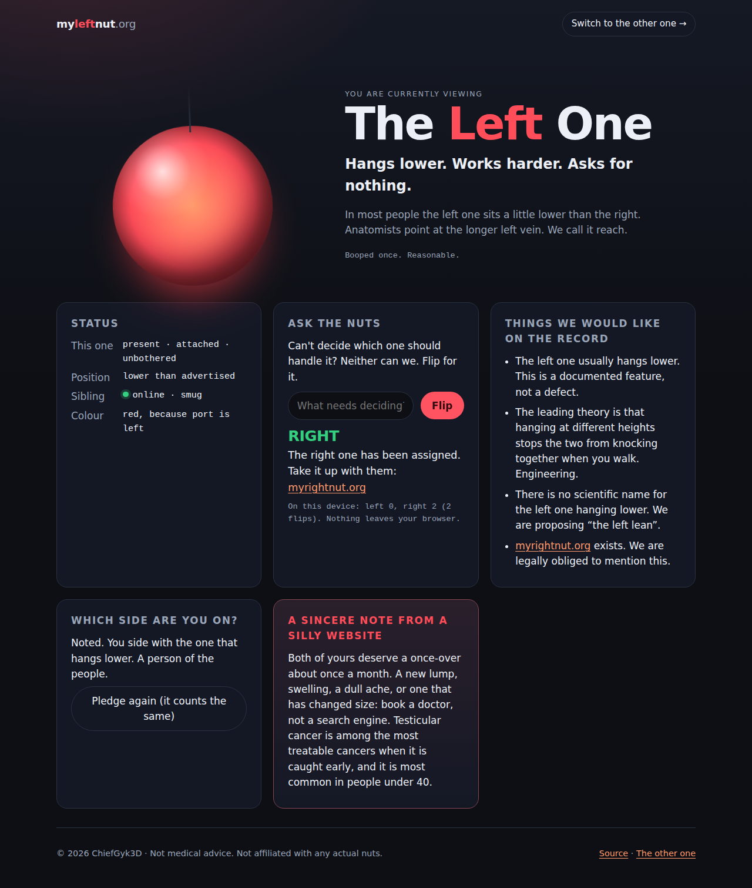
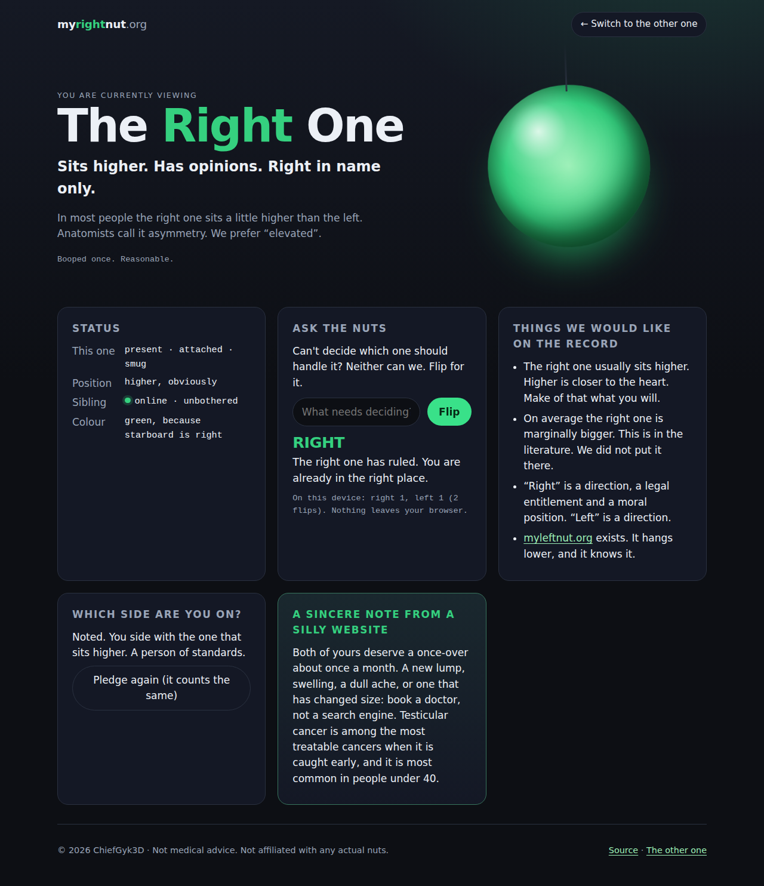
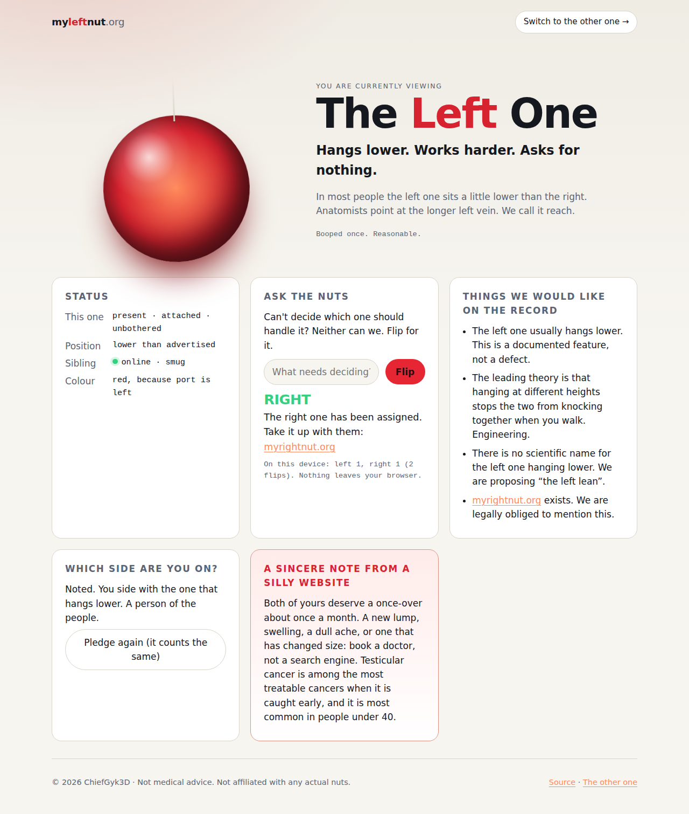
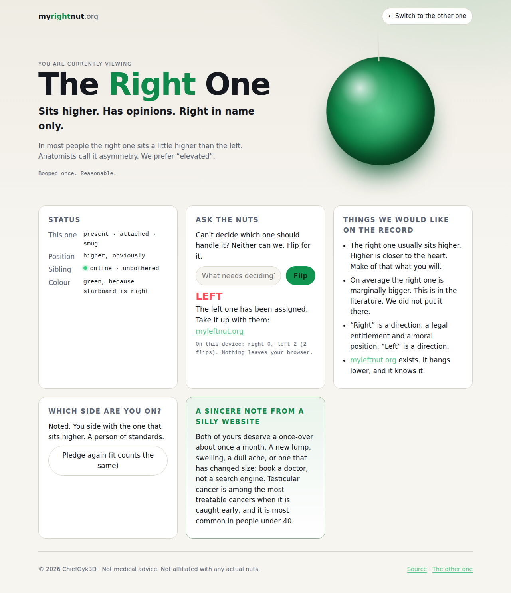

# nuts-dot-org

Two domains, one repo, zero backend.

| Site | What it is | Colour |
|---|---|---|
| **[myleftnut.org](https://myleftnut.org)** | The left one. Hangs lower. Works harder. Asks for nothing. | Red, because port is left |
| **[myrightnut.org](https://myrightnut.org)** | The right one. Sits higher. Has opinions. Right in name only. | Green, because starboard is right |

Each site is a hand-written static page that knows about exactly one other
website. The two share a stylesheet and a script byte for byte; everything that
differs hangs off `<html data-side="left|right">`.

What they do:

- **Boop the orb.** It jiggles. A counter in your own browser keeps score and
  gets progressively less patient with you.
- **Sibling status.** Each site fetches the other's `/status.json` from the
  browser and reports whether the other one is online and what mood it is in.
  That is the only network request either page makes.
- **Ask the nuts.** A coin flip for decisions that deserve one. A losing flip
  sends you to the winner's domain to take it up with them.
- **Pledge allegiance.** Stored in `localStorage`. There is no server, so the
  "unofficial tally" is one person: you.
- **A sincere note.** Both sites end with a short, real reminder that monthly
  self-checks are worth doing.
- **404 pages** with the appropriate amount of judgement.

No analytics, no cookies, no third-party anything. The `_headers` file ships a
`default-src 'none'` CSP with `connect-src` opened only to the sibling, and
`tests/test_sites.py` fails if a page ever loads something from anywhere else.

## Layout

```
sites/
  left/
    netlify.toml      publish = "public", no build command
    public/           what gets deployed to myleftnut.org
      index.html  404.html  style.css  app.js  status.json
      favicon.svg  robots.txt  _headers
  right/              the same shape, for myrightnut.org
tests/test_sites.py   stdlib checks over the deployable files (pytest)
scripts/render.mjs    Chromium render of both sites: errors fail it, screenshots out
.github/workflows/    CI: tests + render, actions pinned to commits
```

`style.css`, `app.js` and `robots.txt` must stay identical between the two
sides; a test enforces it. Edit one, copy it to the other.

## Running locally

```sh
make serve     # left on http://localhost:8001/, right on http://localhost:8002/
make test      # pytest, no network, about a second
make render    # needs node + playwright: npm install --no-save playwright && npx playwright install chromium
make check     # both
```

`make serve` runs both sides so the sibling check on each page resolves. The
script detects `localhost` and looks for the other side on the other port.

## Deploying

There is no build step. Each host serves `sites/<side>/public/` as it is and
reads `_headers` from it. Set up **two** sites or projects from this one repo,
one per domain.

### Cloudflare Pages

For each side, create a Pages project connected to this repository:

| Setting | left | right |
|---|---|---|
| Production branch | `main` | `main` |
| Root directory | `sites/left` | `sites/right` |
| Build command | *(empty)* | *(empty)* |
| Build output directory | `public` | `public` |

Then add the custom domain (`myleftnut.org` or `myrightnut.org`) to the
project. If the DNS is already on Cloudflare the records are created for you;
add `www` as well if you want it, and Pages redirects it. Cloudflare honours
`_headers` and serves `404.html` for missing paths on its own.

### Netlify

For each side, create a site from this repository:

| Setting | left | right |
|---|---|---|
| Base directory | `sites/left` | `sites/right` |
| Build command | *(empty)* | *(empty)* |
| Publish directory | `sites/left/public` | `sites/right/public` |

Netlify reads `sites/<side>/netlify.toml` from the base directory, which says
the same thing, so the UI values only need to agree with it. Add the custom
domain under *Domain management* and point the apex at Netlify's load balancer
(or use Netlify DNS). Netlify honours `_headers` and `404.html` too.

### Afterwards

Open each site and look at the **Sibling** row in the status card. It should
read `online · smug` on the left site and `online · unbothered` on the right.
If it reads *unreachable*, the other side is not deployed yet, or its
`_headers` is not being served (the CORS line on `/status.json` is what the
browser needs).

## Changing things

- Keep each page free of inline scripts, inline styles and remote resources.
  The CSP forbids them and the tests check before the browser does.
- Run `make check` before pushing. The render job is the one that catches
  things the tests cannot see; look at the screenshots it writes.
- Actions in CI are pinned to commits. Resolve a new pin with
  `git ls-remote --tags https://github.com/<owner>/<action>`; never type one
  from memory. Dependabot keeps them moving.

## Licence

MIT. See `LICENSE`. The sincere note is not medical advice; the rest is not
advice of any kind.

## What they look like

CI renders these (`scripts/render.mjs`) and `make render` refreshes them.

| myleftnut.org | myrightnut.org |
|---|---|
|  |  |
|  |  |
